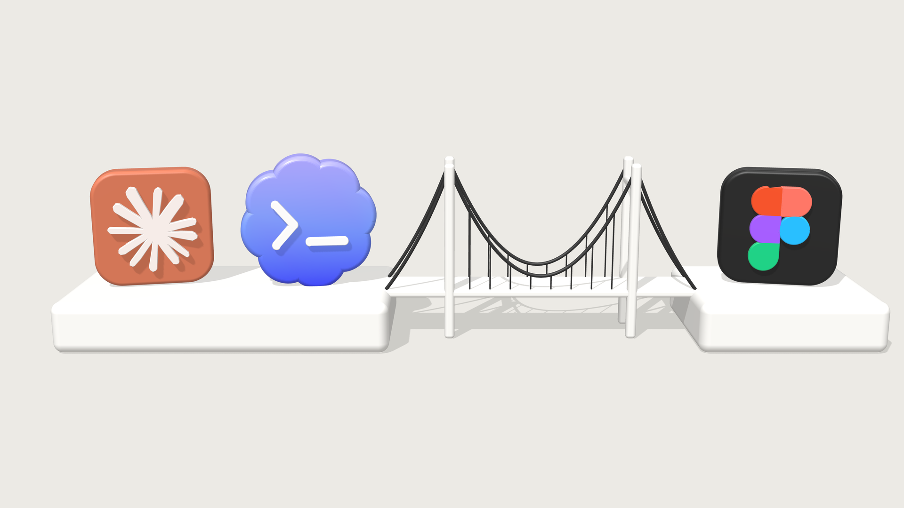
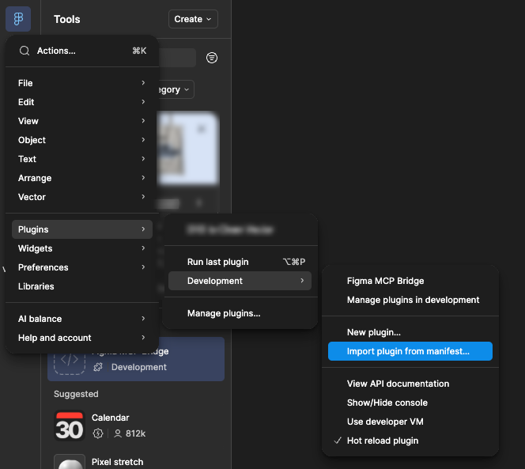
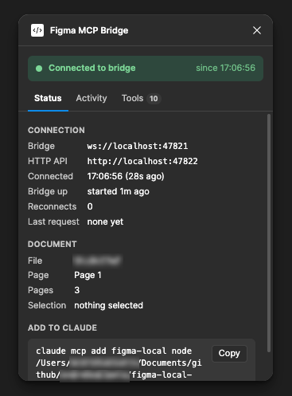

# Figma Local MCP Plugin



**Unofficial Figma MCP for the free plan: no Dev Mode, no paid seat, no rate limits.**

## Why

Figma's own MCP rate-limits free accounts fast, and the local one needs Dev Mode (paid). This plugin skips both.

## Architecture

```
Figma Desktop → Figma Plugin → WebSocket Bridge → MCP Server → Claude/Codex
```

1. **Figma Plugin** - Runs in Figma Desktop with full access to the Plugin API
2. **Bridge Server** - WebSocket server that receives data from the plugin
3. **MCP Server** - Exposes Figma tools to Claude via MCP protocol

## Setup

### 1. Build the plugin

```bash
bun install
bun run build-plugin
```

### 2. Install the Figma Plugin

1. Open Figma Desktop
2. Go to Plugins → Development → Import plugin from manifest
3. Select `/figma-plugin/manifest.json`
4. The plugin will appear in your Plugins menu



### 3. Start the Bridge Server

In a terminal, run:

```bash
bun run bridge
```

This starts:

- WebSocket server on `ws://localhost:47821` (for Figma plugin)
- HTTP API on `http://localhost:47822` (for MCP server)

Then run the plugin in Figma (Plugins → Development → Figma MCP Bridge). Once it connects, the Status tab shows the bridge URLs, the open file and the command for step 4:



### 4. Add to Claude

Use the absolute path to `mcp.js`. The plugin's Status tab shows the exact command with a Copy button.

```bash
claude mcp add figma-local node /absolute/path/to/figma-local-mcp-bridge/mcp.js
codex mcp add figma-local node /absolute/path/to/figma-local-mcp-bridge/mcp.js
```

Validate using

```bash
claude mcp list
codex mcp list
```

Remove using

```bash
claude mcp remove figma-local
codex mcp remove figma-local
```

Replace the path with your actual project path.

### 5. Run the Plugin

1. Open any Figma file
2. Go to Plugins → Development → Figma MCP Bridge
3. The plugin UI should show "Connected to bridge"

## Available Tools

- `get-figma-document` - Get current document structure
- `get-current-page` - Get detailed info about active page
- `get-selection` - Get currently selected nodes
- `get-all-pages` - List all pages
- `find-nodes` - Search for nodes by name
- `get-node-properties` - Get detailed properties of a node
- `export-node` - Export node as PNG/SVG/JPG
- `check-bridge-status` - Check if everything is connected

## Benefits vs API-based Approach

✅ No API key needed
✅ No rate limits
✅ Works with private/local files

## Troubleshooting

**Plugin shows "Disconnected":**

- Make sure the bridge server is running (`bun run bridge`)
- Check that nothing else is using port 47821/47822

**Claude can't access Figma:**

- Verify the bridge server is running
- Run `check-bridge-status` tool to see connection state
- Make sure the plugin is open in Figma

**Build errors:**

- Run `bun install` to ensure all dependencies are installed
- For plugin TypeScript errors, run `bun run build-plugin`

## Development

### Project Structure

```
figma-local-mcp-bridge/
├── figma-plugin/
│   ├── manifest.json       # Plugin manifest
│   ├── code.ts            # Plugin main code (source)
│   ├── code.js            # Built by `bun run build-plugin`, loaded by Figma
│   ├── ui.html            # Plugin UI
│   └── tsconfig.json      # TypeScript config
├── bridge-server.js       # WebSocket bridge
├── ports.js              # Shared WS/HTTP ports
├── tools.js              # MCP tool list (used by mcp.js and the plugin UI)
├── mcp.js                # MCP server with Figma tools
└── package.json
```

### Adding New Tools

1. Add an entry to `tools.js` (name, title, description, params). `mcp.js` registers it automatically and the plugin lists it in its Tools tab
2. Add a matching `case` in `figma-plugin/code.ts` (action switch statement)
3. Rebuild plugin: `bun run build-plugin`

## Credits

Based on [Figma-Local-MCP-Server](https://github.com/suulola/Figma-Local-MCP-Server) by Oluwaseyi Peter Suulola.

## License

[ISC](LICENSE)

Not affiliated with or endorsed by Figma.
